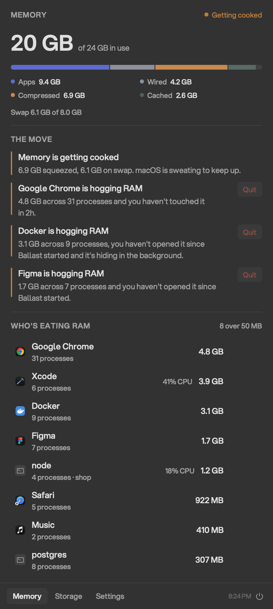
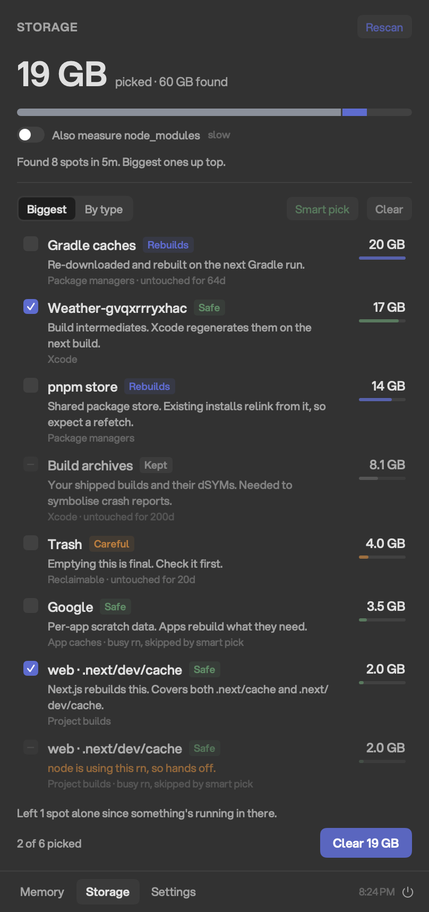

# Ballast

[](https://github.com/tekcify/ballast/actions/workflows/ci.yml)
[](LICENSE)


A small app for Windows and Mac that shows where your memory goes and clears the caches you can safely lose.

<p align="center">
  
  &nbsp;
  
</p>

Your computer has plenty of RAM and it's still slow. Ballast sits in your system tray or menu bar, watches memory and disk, and tells you two things:

- **Which app is hogging memory**, and lets you quit it in one click.
- **Which caches you can delete** without breaking anything.

It never deletes anything you didn't tick and confirm.

## Install

There are no prebuilt downloads yet, so you build it from source. It takes about a minute.

| | Windows | Mac |
| --- | --- | --- |
| You need | Windows 10 or 11 and the [.NET 10 SDK](https://dotnet.microsoft.com/download/dotnet/10.0) | macOS 14 or later and Xcode 26 or later |
| Run | `git clone https://github.com/tekcify/ballast.git`<br>`cd ballast\windows`<br>`.\build.ps1` | `git clone https://github.com/tekcify/ballast.git`<br>`cd ballast`<br>`./build.sh` |
| It lands in | Your user folder and the Start menu, no admin needed | Your Applications folder |

Either way, Ballast starts with your computer from then on. You can turn that off in Settings.

On Windows, click the tray icon to open it. If Windows tucks the icon into the overflow arrow, drag it onto the taskbar so it stays visible.

## What you get

**Memory.** A live breakdown of what's using your RAM, with apps grouped together so Chrome's dozens of helper processes show up as one row. Under "The move", Ballast suggests what to quit, based on how much an app uses, how long since you touched it, and whether its memory keeps climbing. It won't suggest anything the system needs, and it won't tell you to quit the app you're using unless things are critical.

**A heads-up.** When memory runs low, Ballast tells you without stealing focus. On Windows a small card appears above the tray. On a Mac it drops out of the notch. Dismiss it and it stays quiet for 15 minutes, or snooze it for an hour.

**Storage.** One scan finds developer caches and ranks them biggest first: npm, pnpm, Yarn, Bun, pip, uv, Go, Cargo, Gradle, Maven, NuGet, Playwright, Xcode, Next.js, Turbo, Vite and more, plus temp files and the Recycle Bin or Trash. **Smart pick** ticks the safe ones for you.

## How it keeps your files safe

Every cache gets a tier:

| Tier | What it is | What happens |
| --- | --- | --- |
| Safe | Rebuilds itself | Deleted, and picked for you |
| Rebuilds | Costs a download or a rebuild | Moved to the Recycle Bin or Trash |
| Careful | Your real stuff | Moved to the Recycle Bin or Trash, never picked for you |
| Kept | Measured only | Never deleted |

On top of that:

- Ballast only deletes inside your home folder, apart from emptying the Recycle Bin or Trash when you pick it. Documents, Desktop, Pictures, OneDrive, `.git`, `.ssh` and AI assistant folders are always off limits.
- A project with a running dev server keeps its cache. Ballast checks again right before deleting.
- Anything written to in the last 10 minutes is never picked for you.
- Every deletion is logged, so you can see exactly what went.

## Check it without the UI

Ballast can print what it sees and exit. The storage check is a dry run and deletes nothing.

Windows (PowerShell):

```powershell
& "$env:LOCALAPPDATA\Programs\Ballast\Ballast.exe" --diagnostic snapshot | Out-Host
& "$env:LOCALAPPDATA\Programs\Ballast\Ballast.exe" --diagnostic scan | Out-Host
```

Mac (Terminal):

```sh
BALLAST_DIAGNOSTIC=1    /Applications/Ballast.app/Contents/MacOS/Ballast
BALLAST_DIAGNOSTIC=scan /Applications/Ballast.app/Contents/MacOS/Ballast
```

## Contributing

Bug reports, new cleanup targets and fixes are welcome on either platform. [CONTRIBUTING.md](CONTRIBUTING.md) explains the setup. Please report anything that could delete the wrong files privately, as described in [SECURITY.md](SECURITY.md).

## License

[MIT](LICENSE) © 2026 Tekcify Technologies Ltd
