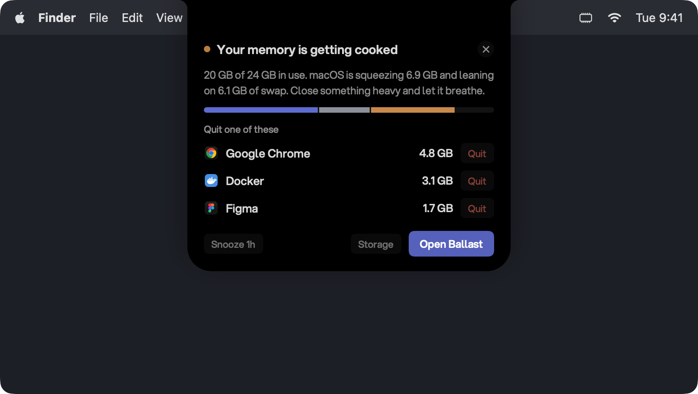
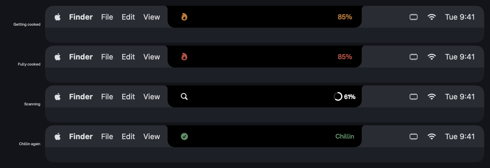
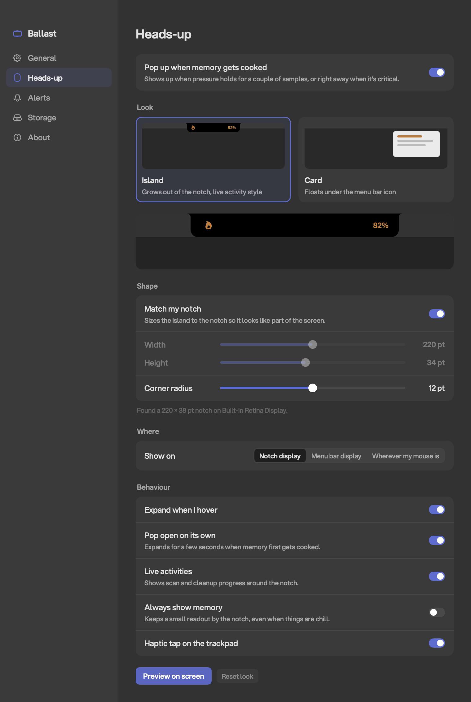

# Ballast

[](https://github.com/tekcify/ballast/actions/workflows/ci.yml)
[](LICENSE)




Your Mac has 24 GB of RAM and it's still swapping. Ballast sits in your menu bar, watches memory and disk, and tells you which app is hogging RAM and which caches you can delete without breaking anything.

When memory gets cooked, Ballast drops out of the notch like a Dynamic Island, names the apps worth quitting and lets you quit them from right there. Once pressure eases it says so and gets out of your way.

It's Swift and SwiftUI with zero dependencies, and it never deletes anything you didn't tick and confirm.

## The island



The island hugs the notch and keeps a tiny live readout on either side of it. Orange flame means memory is under pressure, red means it's fully cooked, a ring means a scan or cleanup is running, and a green check means you're good again.

Hover over it and it opens up with the full story. **Open Ballast** turns it into the whole panel, and **Storage** takes you straight to cleanup. It never steals focus, so whatever you're typing keeps the keyboard.

It shows up when pressure holds for a couple of samples, or right away when things go critical. Dismiss it and it stays quiet for 15 minutes unless memory gets worse. Snooze buys you an hour.

### Make it yours

Everything lives in the Heads-up page of Settings, with a live preview that redraws as you drag:

- Match your notch exactly, or set your own width and height
- Corner radius from sharp to pill
- Show it on the notch display, the menu bar display, or wherever your mouse is
- Expand on hover, pop open on its own, and a small haptic tap on the trackpad
- Live activities for scans and cleanups
- An always-on memory readout by the notch, if you like having it there

Displays without a notch get a matching pill hanging from the top of the screen. If you'd rather keep it low key, switch the look to Card and it floats under the menu bar icon instead.

<p align="center">
  
</p>

## Memory and storage

<p align="center">
  
  &nbsp;
  
</p>

The Memory tab splits what's in use into app, wired, compressed and cached memory, and the numbers line up with `vm_stat` and Activity Monitor. Apps are listed by their real footprint, with helper processes grouped under the app they belong to, so Chrome's dozens of helpers show up as one row and two dev servers in different projects stay separate.

Under "The move", Ballast suggests what to quit. It looks at how much an app uses, how long since you last touched it, whether it's hidden, and whether its memory keeps climbing. It won't suggest anything macOS depends on, and it won't tell you to quit the app you're using unless pressure is critical. Quitting asks nicely first, the way the Dock does, so apps get a chance to save. `SIGKILL` only happens if the app is still hanging around after a grace period.

The Storage tab scans dev caches and ranks them biggest first, so the 20 GB Gradle cache isn't hiding under a 40 MB log folder. It covers:

- Xcode derived data, device support and simulator caches
- Package manager caches: npm, pnpm, Yarn, Bun, SwiftPM, Homebrew, pip, uv, Go, Cargo, Gradle, Maven, Playwright and Puppeteer
- Project build caches from Next.js, Turbo, Vite, SvelteKit and Angular
- App caches, logs and the Trash

**Smart pick** ticks the safe caches plus anything that rebuilds itself and hasn't been touched in 30 days. It skips folders an app wrote to in the last few minutes, and any project with a running process inside it, so a live dev server keeps its cache. Ballast checks for running processes again right before it deletes, since results can be hours old. Scan results also stick around after a restart, so the Storage tab isn't empty every time you log in.

| Tier | What it is | What happens |
| --- | --- | --- |
| Safe | Regenerates by itself | Deleted, and picked for you |
| Rebuilds | Costs a download or a rebuild | Moved to the Trash, picked by Smart pick after 30 idle days |
| Careful | Your real stuff | Moved to the Trash, never picked for you |
| Kept | Measured only | Never deleted |

Anything that goes to the Trash still takes up space until you empty it, and Ballast tells you how much is sitting there. `node_modules` folders are off by default because there are usually hundreds of them; flip the toggle on the Storage tab when you want them measured. Every deletion is logged to `~/Library/Application Support/Ballast/cleanup-log.jsonl`.

## Install

You need macOS 14 or later and Xcode 26 or later (Swift 6.2).

```sh
git clone https://github.com/tekcify/ballast.git
cd ballast
./build.sh
```

`build.sh` builds a release, assembles `Ballast.app`, signs it and copies it to `/Applications` (or `~/Applications` if that isn't writable). Open it once and it lives in your menu bar from then on. Turn on "Start Ballast at login" in Settings and it'll be there after every restart; if macOS wants your OK first, Ballast tells you and links straight to Login Items. Use `./build.sh --no-install` to leave the app in `build/` instead.

### Signing and notifications

The script signs with the first `Developer ID Application` identity in your keychain. Without one it signs ad-hoc, which is fine except that macOS refuses system notifications to ad-hoc signed apps, so Ballast falls back to plain AppleScript notifications without action buttons.

To pick a specific identity:

```sh
BALLAST_SIGN_IDENTITY="Developer ID Application: Your Name (TEAMID)" ./build.sh
```

macOS remembers a notification denial per bundle identifier, and signing again later doesn't clear it. If you plan to use a real identity, sign with it before the first launch.

### Font

Ballast uses the [Aspekta](https://github.com/ivodolenc/aspekta) typeface when `AspektaVF.ttf` is in `~/Library/Fonts`, and the system font otherwise. The build bundles it automatically when it's there.

## How it works

### Memory readings

System figures come from `host_statistics64`. Per app memory is `phys_footprint` from `proc_pid_rusage`, the same number as Activity Monitor's Memory column.

Processes owned by root refuse `proc_pid_rusage` without elevated privileges. For those, Ballast falls back to resident size from `ps` and labels the figure as approximate.

Summed per app figures read higher than the system total, because shared framework pages are counted once in every process that maps them.

### The deletion guard

`DeletionGuard` is the last check before anything is removed. It's built from the same target list the scanner uses, so a path no target could have produced gets refused even if it reaches the cleaner some other way. It also refuses:

- anything outside your home folder, or the home folder itself
- anything less than two levels deep
- anything inside `.git`, `.ssh`, `.gnupg`, `.aws`, `.kube`, or local AI assistant folders (`.codex`, `.claude`, `.cursor`, `.agents`, `.openai`)

## Diagnostics

The app binary doubles as a command line tool for checking its readings without the UI. Each mode prints its result and exits.

```sh
BALLAST_DIAGNOSTIC=1 /Applications/Ballast.app/Contents/MacOS/Ballast
```

| `BALLAST_DIAGNOSTIC` | What it does |
| --- | --- |
| `1` | Prints one memory snapshot and the current advice |
| `scan` | Dry run of the storage scan: every item, what would be picked and what the guard refuses. Deletes nothing. Add `BALLAST_DEEP=1` to include `node_modules` |
| `layout` | Lays out each pane offscreen and fails if the popover would collapse |
| `render` | Renders the panes, the card, the island states and the settings window to `/tmp/ballast-*.png` |
| `notify` | Sends a test alert and reports which delivery path carried it |
| `headsup` | Shows the heads-up card for ten seconds with pressure faked, so you can see it without running out of memory |
| `readme` | Renders the screenshots in this README from sample data into `assets/`, or `BALLAST_OUT` if set |

`BALLAST_SELFTEST=headsup` checks the running app instead. It confirms monitoring starts without the panel ever opening, the heads-up shows and hides, the island sits flush with the notch, and Open Ballast expands into the full panel. It exits 1 if any of that fails.

Run the `scan` dry run before trusting a cleanup on a new machine, and `swift test` before sending a change.

The screenshots above come from `readme` mode, so they're the real views with made-up numbers. None of them show anyone's actual Mac.

## Good to know

A full storage scan can take a few minutes on a machine with lots of projects, because `du` has to walk big stores like `~/.gradle/caches` and the pnpm store. Results show up as they're measured, the island shows progress while you wait, and you can stop the scan any time.

## Contributing

Bug reports, new cleanup targets and fixes are welcome. Read [CONTRIBUTING.md](CONTRIBUTING.md) to get set up, and please report anything that could delete the wrong files privately, as described in [SECURITY.md](SECURITY.md).

## License

[MIT](LICENSE) © 2026 Tekcify Technologies Ltd
